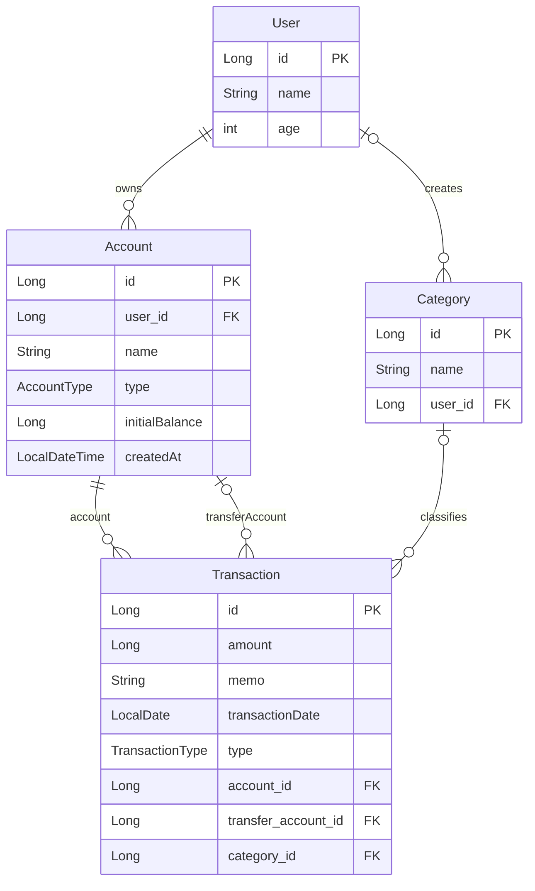

# Moneta DB 설계서

작성일: 2026-10-06 · 버전: 0.1 · 기준: 대화에서 작성·검토한 JPA 엔티티

## 1. 목적과 범위

사용자의 수입·지출을 기록하고, 생활비·저축·투자 사이의 자금 배분을 관리한다. 은행별 계좌 연동이 아니라 사용자가 정한 자산 묶음으로 돈을 관리한다.

- 일별·월별 수입 및 소비 합계
- 카테고리별 통계와 이전 달 비교
- 생활비·저축·투자 간 자금 이동
- 기록된 거래에 따른 자산 잔액 변화

로그인 ID·비밀번호 및 인증 기능은 이후 추가한다. 투자 평가손익은 현재 범위에 포함하지 않는다.

이 문서는 설계 및 제공된 코드의 상태를 정리한 것이며, 실제 DB 생성·저장 검증을 완료했다는 의미는 아니다. 아래 SQL 타입은 논리적 대응 예시이며 실제 생성 DDL은 실행 환경에서 확인한다. 테이블명은 엔티티 이름으로 표기하며, 물리 테이블명과 명명 전략은 아직 확정하지 않았다.

## 2. 엔티티 개요

| 엔티티 | 역할 |
|---|---|
| User | 회원 정보 |
| Account | 회원이 소유한 생활비·저축·투자 자산 묶음 |
| Category | 공통 또는 회원별 거래 분류 |
| Transaction | 개별 수입·지출·이체 기록 |

## 3. ERD



Account.createdAt은 마지막으로 제공된 코드에 존재하므로 표시했다. 자동 입력 추가 또는 제거 여부는 확인이 필요하다. Transaction.createdAt은 사용자의 결정에 따라 제외했다.

## 4. 필드 명세

### 4.1 User

| 필드 | Java 타입 | SQL 타입 예시 | NULL | 키·설정 | 의미 |
|---|---|---|---|---|---|
| id | Long | BIGINT | 불가 | PK, IDENTITY | 회원 식별자 |
| name | String | VARCHAR(100) | 불가 | 최대 100자 | 이름 |
| age | int | INT | 불가 | 아래 검증 참조 | 나이 |

이름에는 `@NotBlank`, `@Size(max = 100)`, 나이에는 `@Positive`, `@Max(199)`가 적용되어 있다. Bean Validation 실행 시 이름의 공백 값과 길이, 나이 1~199 범위를 검사한다. 이 검증을 DB CHECK 제약조건이 명시적으로 작성되었다는 의미로 해석하지 않는다.

PK는 자동 생성하며 연속 번호를 보장하지 않는다. 현재 로그인 정보와 성별은 없다.

### 4.2 Account

| 필드 | Java 타입 | SQL 타입 예시 | NULL | 키·설정 | 의미 |
|---|---|---|---|---|---|
| id | Long | BIGINT | 불가 | PK, IDENTITY | 자산 묶음 식별자 |
| user | User | BIGINT | 불가 | user_id FK → User.id | 소유자 |
| name | String | VARCHAR(100) | 불가 | 최대 100자 | 생활비, 비상금 등의 이름 |
| type | AccountType | 문자열 기반 enum | 불가 | EnumType.STRING | 자산 종류 |
| initialBalance | Long | BIGINT | 불가 | 초기 금액 | 기록 시작 시 보유액 |
| createdAt | LocalDateTime | DATETIME | 불가 | updatable=false | 등록 시각, 처리 미확정 |

AccountType은 코드의 표기를 따라 `LIVING`, `SAVING`, `INVESTMENT`를 사용한다. 같은 사용자에게 같은 type의 Account가 여러 개 존재할 수 있다. 예를 들어 비상금과 여행 자금은 모두 SAVING이며, 각각의 id로 구분된다. name의 중복을 제한하는 제약은 현재 없다.

금액은 원화 정수 단위를 가정한다. initialBalance는 과거부터 보유한 돈으로, 이번 달 수입에 포함하지 않는다. 이후 거래마다 초기 잔액을 변경하는 방식으로 사용하지 않는다.

```text
현재 잔액 = initialBalance
          + account가 해당 계좌인 INCOME 금액 합계
          - account가 해당 계좌인 EXPENSE·TRANSFER 금액 합계
          + transferAccount가 해당 계좌인 TRANSFER 금액 합계
```

현재 잔액을 저장하는 별도 필드는 없다. 투자 묶음의 잔액은 기록된 자금 이동 기준이며 현재 시장 평가액을 뜻하지 않는다.

### 4.3 Category

| 필드 | Java 타입 | SQL 타입 예시 | NULL | 키·설정 | 의미 |
|---|---|---|---|---|---|
| id | Long | BIGINT | 불가 | PK, IDENTITY | 카테고리 식별자 |
| name | String | VARCHAR(100) | 불가 | 최대 100자 | 식비, 교통비, 월급 등 |
| user | User | BIGINT | 허용 | user_id FK → User.id | 개인 카테고리 소유자 |

- user_id가 NULL이면 공통 카테고리이다.
- user_id가 있으면 해당 회원의 개인 카테고리이다.
- 사용자에게 공통 카테고리와 본인의 개인 카테고리를 함께 제공한다.
- 개인 카테고리는 소유자만 수정·삭제하고, 공통 카테고리는 서비스가 관리한다. 이 권한 검사는 이후 구현한다.

카테고리 이름의 UNIQUE 제약과 수입·지출 전용 분류 필드는 현재 없다.

### 4.4 Transaction

| 필드 | Java 타입 | SQL 타입 예시 | NULL | 키·설정 | 의미 |
|---|---|---|---|---|---|
| id | Long | BIGINT | 불가 | PK, IDENTITY | 거래 식별자 |
| amount | Long | BIGINT | 불가 | 양수 규칙은 추가 검증 필요 | 거래 금액 |
| memo | String | VARCHAR | 허용 | 길이 직접 지정 없음 | 메모 |
| transactionDate | LocalDate | DATE | 불가 | 실제 거래 날짜 | 기간별 집계 기준 |
| type | TransactionType | 문자열 기반 enum | 불가 | EnumType.STRING | INCOME / EXPENSE / TRANSFER |
| account | Account | BIGINT | 불가 | account_id FK → Account.id | 수입·지출의 거래 계좌, 이체의 출금 계좌 |
| transferAccount | Account | BIGINT | 허용 | transfer_account_id FK → Account.id | 이체받는 계좌. 수입·지출에서는 비움 |
| category | Category | BIGINT | 허용 | category_id FK → Category.id | 거래 분류 |

거래 계좌 구조는 2026-10-24에 `account`·`transferAccount`로 변경했다. 기존 DB 이전 방법은 [거래 계좌 이전 안내](docs/db/transaction-account-migration.md)를 참고한다. 나머지 항목은 초기 설계 기록이므로 실제 코드를 우선한다.

## 5. 관계 및 거래 규칙

| 관계 | 의미 |
|---|---|
| User → Account | 회원 하나에 Account 0개 이상. 각 Account는 회원 1명 필수 |
| User → Category | 회원 하나에 개인 Category 0개 이상. Category의 소유자는 0명 또는 1명 |
| Account → Transaction (거래 계좌) | 거래마다 account 1개 필수. 이체에서는 출금 계좌 |
| Account → Transaction (이체 도착) | 이체마다 transferAccount 1개 필수. 수입·지출에서는 없음 |
| Category → Transaction | Category 하나로 여러 거래 분류. 거래마다 Category는 0개 또는 1개 |

Java에서는 객체를 참조하고, DB에서는 대상 객체의 PK를 FK 컬럼에 저장한다. 현재 관계 필드는 모두 ManyToOne이다. Transaction에 별도의 user_id는 없으며, 연결된 Account의 소유자로 사용자를 판단한다. Category.user는 거래 소유자가 아니라 카테고리 소유자이다.

| 거래 유형 | account | transferAccount | category | 전체 자산 영향 |
|---|---|---|---|---|
| INCOME | 필수 | 없음 | 수입 분류 연결 가능 | 증가 |
| EXPENSE | 필수 | 없음 | 지출 분류 연결 가능 | 감소 |
| TRANSFER | 필수 | 필수 | 현재 설계에서는 비움 | 변화 없음 |

수입·지출의 category도 현재 코드상 NULL이 허용된다. 필수로 강제할지는 추후 결정한다.

다음은 엔티티 매핑만으로 보장되지 않으므로 거래 생성·수정 시 검증해야 한다.

1. amount는 0보다 커야 한다.
2. 유형별 출발·도착 필수 여부를 지킨다.
3. 이체의 출발·도착 Account는 서로 달라야 하며 같은 사용자 소유여야 한다.
4. 사용자는 자신의 Account만 거래에 사용할 수 있다.
5. 선택한 Category는 공통 또는 본인 소유여야 한다.

## 6. 기록 예시와 통계

초기 잔액이 모두 0원인 생활비·저축·투자 묶음을 가정한다.

| 거래 | type | amount | account | transferAccount | category |
|---|---|---:|---|---|---|
| 월급 수령 | INCOME | 3,000,000 | 생활비 | 없음 | 월급 |
| 점심 결제 | EXPENSE | 9,000 | 생활비 | 없음 | 식비 |
| 저축 배분 | TRANSFER | 1,000,000 | 생활비 | 저축 | 없음 |
| 투자 배분 | TRANSFER | 500,000 | 생활비 | 투자 | 없음 |

기록 후 생활비 1,491,000원, 저축 1,000,000원, 투자 500,000원으로 전체 자산은 2,991,000원이다. 수입은 3,000,000원, 소비는 9,000원이다. 저축·투자 이체를 소비에 포함하지 않는다.

| 통계 | 집계 기준 |
|---|---|
| 일별·월별 수입 | transactionDate 기간 + INCOME의 amount 합계 |
| 일별·월별 소비 | transactionDate 기간 + EXPENSE의 amount 합계 |
| 카테고리별 소비 | 기간과 EXPENSE 조건으로 category별 합산 |
| 이전 달 비교 | 두 기간을 각각 집계한 뒤 차이 계산. 이전 달이 0원이면 증감률을 별도 처리 |
| 저축·투자 이동 | 관련 Account의 TRANSFER 유입·유출을 구분해 집계 |
| 자산 추이 | 초기 잔액과 해당 날짜까지의 거래를 Account별로 계산한 뒤 합산 |

저축 묶음 사이의 이동은 전체 저축 증가로 중복 집계하지 않도록 한다. 진행 중인 달과 이전 달 전체를 비교할지, 같은 일수까지 비교할지도 통계 구현 시 정한다.

## 7. 남은 확인 사항

- Account.createdAt: 자동 입력을 추가하거나 필드를 제거해야 한다. 마지막 코드에는 자동 입력 로직이 없다.
- Transaction: account·transferAccount로 변경 완료. 기존 DB 데이터 이전 및 실제 조회 검증 필요.
- DB 연결 및 실제 테이블 생성·저장 검증.
- Account·Category 삭제 시 기존 거래를 어떻게 보존할지 정책 결정. 삭제 전파는 현재 명시하지 않았다.
- 과거 자산 추이: 초기 잔액이 어느 날짜 기준인지와 그 이전 거래 입력 규칙을 정해야 한다. 현재 별도 초기 잔액 기준일 필드는 없다.
- 로그인·인증, 투자 평가금액은 추후 확장한다.

오늘 작성한 범위는 네 엔티티의 기본 필드와 관계이다. 다음 구현 단계는 Repository를 이용해 User 한 명을 저장하고 DB 반영을 확인하는 것이다.
